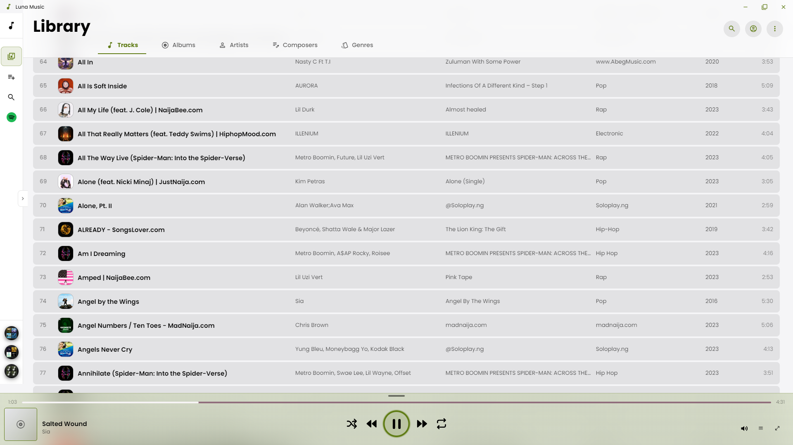
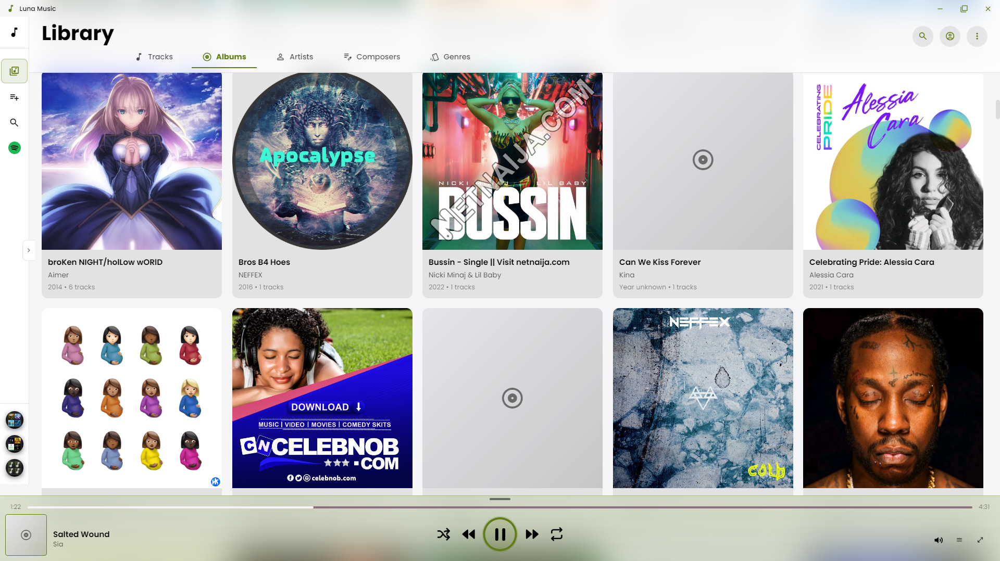
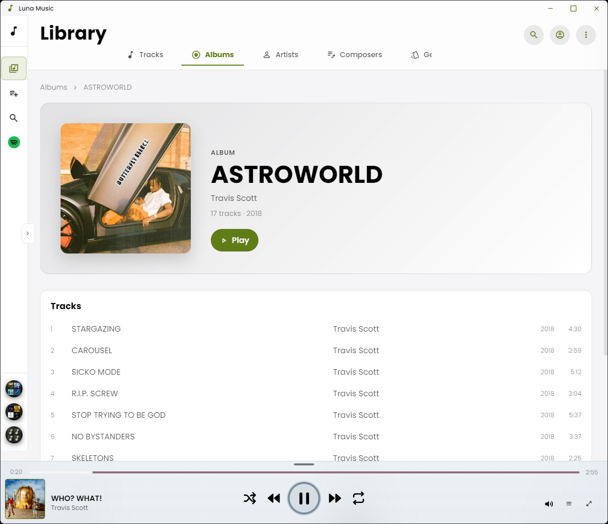
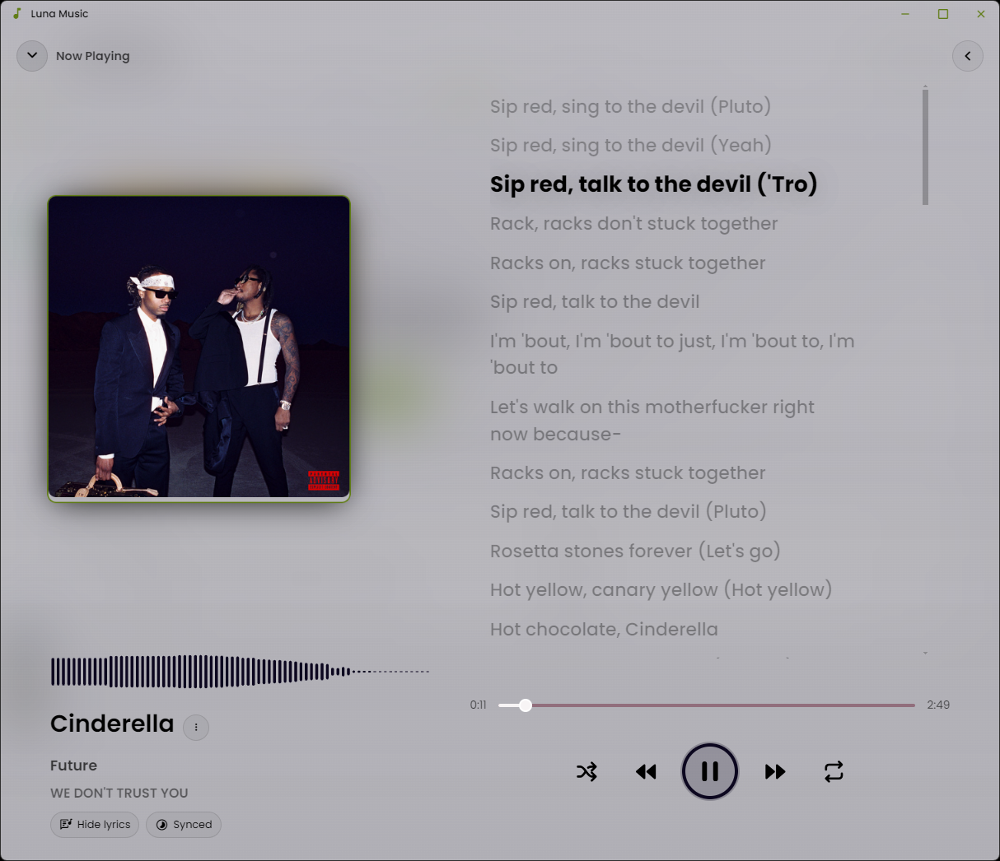
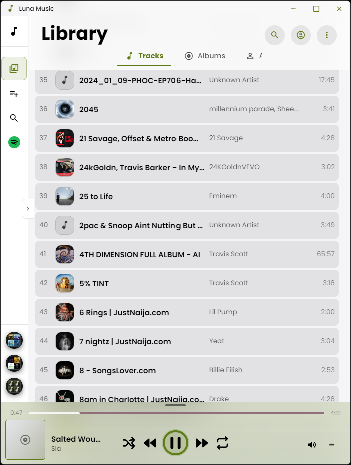
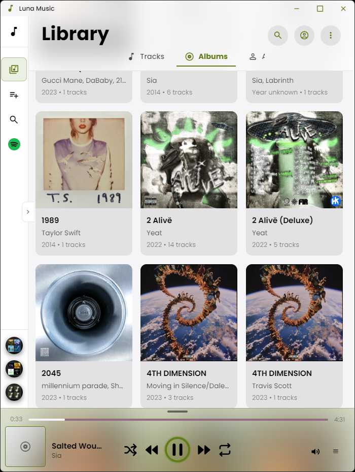
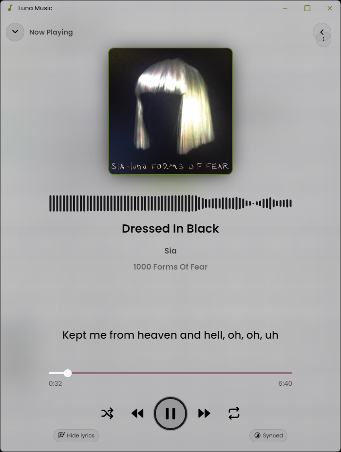

<p align="center">
  
</p>

<h1 align="center">Luna Music</h1>

<p align="center">
  Your music library, beautifully at home on your desktop.
</p>

<p align="center">
  <a href="https://github.com/draco-mordred/Luna/releases/latest">
    
  </a>
  <a href="https://github.com/draco-mordred/Luna/releases">
    
  </a>
  <a href="LICENSE.md">
    
  </a>
</p>

<p align="center">
  <a href="#features">Features</a> ·
  <a href="#screenshots">Screenshots</a> ·
  <a href="#download">Download</a> ·
  <a href="#privacy-and-online-services">Privacy</a> ·
  <a href="https://github.com/draco-mordred/Luna/issues">Support</a>
</p>

Luna is a music player for enjoying a personal music collection in a clean, customizable interface. Browse local tracks and albums, explore artist details, and move from a compact PlayBar to a full Now Playing view with lyrics and visualizations. Luna runs as a desktop app and can also be run in a web browser. The Electron desktop app scans selected folders; the Android app scans audio indexed by Android's media library.

## Features

- **Your local library:** Scan music folders, browse tracks and albums, and organize your listening with search, playlists, shuffle, repeat, and a play queue.
- **A player that stays close:** Keep playback in the bottom PlayBar or expand it into Now Playing. In the Electron app, switch to a resizable mini player or a fullscreen player, and optionally keep Luna above other windows.
- **Lyrics your way:** Display embedded plain or timestamped lyrics, switch between plain and synchronized modes, adjust synchronized lyric timing in five steps in either direction, and share the timing across Now Playing and the PlayBar.
- **Personalized playback:** Choose themes, accent colors, transport icon styles, seek bar designs, and audio visualizer styles. On Windows, use the system accent color throughout active navigation, player controls, and the current track.
- **Rich track details:** View album artwork and metadata, edit supported audio tags and embedded lyrics, and explore artist images and biographies.
- **Discover more music:** Connect to Jamendo or Audiomack for online catalog search and streaming. These integrations may require API credentials and are subject to each provider's access rules and terms.
- **Desktop integration:** On Windows, use playback controls from the taskbar preview and install Luna through the branded setup wizard.
- **Responsive layouts:** Use Luna in a desktop window or a narrower mobile-sized layout.

## Screenshots

<p align="center">
  
  
</p>
<p align="center">
  
  
</p>
<p align="center">
  
  
  
</p>

## Download

<p align="center">
  <a href="https://github.com/draco-mordred/Luna/releases/latest">
    
  </a>
</p>

Visit [GitHub Releases](https://github.com/draco-mordred/Luna/releases/latest) and download **`Luna Setup <version>.exe`** for Windows. The installer includes a language selector, a dark branded setup wizard, and an option to choose the installation folder. It can replace an existing Luna installation while preserving app settings and library data.

## Getting started

1. Download and run the Windows installer from the [latest release](https://github.com/draco-mordred/Luna/releases/latest).
2. On first launch, select one or more folders containing your music.
3. Browse your library and start listening. Customize the app from **Settings**.

Luna indexes supported audio files in selected folders. In the desktop app, right-click a track to edit supported metadata and embedded lyrics. Changes are written to the audio file itself. MP3, FLAC, M4A/MP4, and OGG/OGA files support metadata editing; other supported library formats may still be playable.

On supported Windows 11 versions, choose **Default**, **Mica**, or **Frosty** in **Settings → Appearance → App background material**. Mica uses Windows' subtle wallpaper-tinted material, while Frosty uses Acrylic for a stronger frosted-glass blur. Both material modes use Windows' native window frame and rounded corners; Luna must restart to apply a selection.

The Windows setup installer registers Luna for the audio formats it supports. To make Luna the default, open **Settings → Appearance → Default audio player**, then choose Luna for each desired format in Windows **Default apps**. Windows requires the user to confirm default-app choices. Opening an associated file launches Luna and plays it; when multiple files are opened together, Luna queues them in the selected order. The portable build does not register file associations.

## Privacy and online services

Your local music library is indexed on your device. Online features are optional and use third-party services:

- Artist images and biographies may be looked up through the English Wikipedia API and Wikimedia Commons.
- Jamendo and Audiomack search and playback use their respective APIs and are subject to provider terms, access requirements, and licensing.

Audiomack streaming requires authorized OAuth credentials and is available in the Electron desktop app. Jamendo requires a Client ID. Review each provider's terms and obtain any required permissions before using or distributing those integrations. Luna does not bundle music from these services.

## Building from source

### Requirements

- Node.js and npm
- Windows for building the Windows installer
- For Android: Android Studio, Android SDK Platform 34 or newer, and JDK 17

### Run the desktop app in development

```bash
npm install
npm run dev
```

### Build the production app and installers

```bash
npm run electron:build
```

The Windows installer is written to `dist/`. Its filename includes the app version from `package.json`. To make a build available to users, publish a GitHub Release and attach the installer executable as a release asset rather than committing the large binary to the repository.

### Build and run the Android app

The Android project uses Capacitor, Android SDK Platform 34 or newer, and JDK 17. Set Android Studio's Gradle JDK to JDK 17: **File → Settings → Build, Execution, Deployment → Build Tools → Gradle → Gradle JDK**. If Android Studio selects a newer Java runtime and reports a Gradle compatibility error, select the installed JDK 17 and sync the project again. This Gradle JDK selection is machine-specific and should not be committed.

Open the generated native project in Android Studio:

```bash
npm run android:sync
npm run android:open
```

The Android launcher uses the Luna desktop icon. At startup, Android shows its native splash before Luna displays a centered logo and app name with a loading animation selected for the device's Android API level. Luna launches in immersive mode; swipe from an edge to temporarily reveal the system bars. On Android 12 and newer, Settings → Appearance offers an optional wallpaper-derived Material You accent color; older Android versions continue using Luna's selected accent.

Select an emulator or connected Android device in Android Studio and run the app. On its first library scan, Luna asks for Android audio access and lists audio files indexed by Android's media library. The app caches the track library in IndexedDB for faster startup, then refreshes it in the background after one minute. Album artwork is loaded as needed. Android playback settings can enable a foreground media-playback service, notification transport controls, and lock-screen media controls. Android notification permission is requested when needed. Device manufacturers may still impose battery-management limits; Luna does not silently request exemption from those system policies. Play Store signing and release setup remain follow-up Android work.

On Android, the About page shows the device model and Android version when available, and navigation uses a mobile bottom bar. Album artwork is read through Android's media library. Embedded plain lyrics are extracted from ID3 `USLT` frames in MP3 files; synchronized lyrics are supported from ID3 `SYLT` frames and timestamped `USLT` text.

Artist artwork and biographies use Wikipedia when available, with Wikimedia Commons as a trusted fallback source for images missing from Wikipedia. Android launcher icons use a zoomed-out adaptive foreground to keep the logo within launcher masks.

Android `versionName` follows `package.json`. Its Play Store `versionCode` is derived separately from Luna's month/release/date version fields to remain an increasing integer; Android Play Store releases are not ready until signing and background playback are completed.

Fetch tags before creating a later release, then build:

```bash
git fetch origin --tags
npm run release:build
```

Each version needs a plain-text file at `public/release-notes/<version>.txt`. When preparing a release, add the completed change and bug-fix summary to this file; the app shows it on the first launch of that version, followed by brief summaries from `public/release-notes/previous-releases.json`, and remembers when the dialog is dismissed. Creating a new release notes file also refreshes previous-version summaries from archived notes. The build checks that the current version's notes exist and are not left as the starter placeholder. To start a notes file after updating the version, run `npm run release:notes:create`, then edit the generated file before building.

The release build updates `package.json` and `package-lock.json`, then builds the Electron installers. If the version was advanced and its notes file is not ready, create and complete that file, then run `npm run electron:build`. It does not create a Git commit, tag, or GitHub Release; commit the version change and notes, create and push a matching `v<version>` tag, and attach the installer from `dist/` to a GitHub Release. For a preview without changing files, use `npm run release:version:check`.

Copilot must only run version and release-notes scripts when release preparation or a version preview is explicitly requested. The repository Copilot instructions document this workflow, and a pre-tool hook asks for approval before release scripts or Electron build/package commands run. Enable Copilot hooks in VS Code for this safeguard to run; it applies to Copilot tool calls, not commands you run yourself in a terminal.

## Support

Found a problem or have a feature request? [Open an issue](https://github.com/draco-mordred/Luna/issues).

## License

Luna is distributed under the [MIT License](LICENSE.md).

<!-- TODO: Add a project website or product landing page if one is created. -->

<!-- TODO: Add a privacy-policy link before promoting Luna as a privacy-focused product. -->

<!-- TODO: Publish the v1.0.1 GitHub Release with the Windows installer attached. -->
